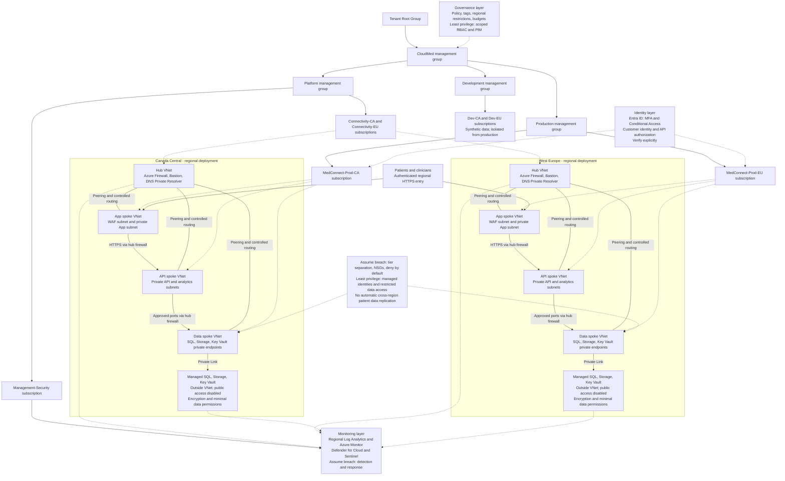

# CloudMed Solutions: Zero Trust Azure Landing Zone

System: MedConnect
Regions: Canada Central and West Europe
Scope: This document is solely about the conceptual architecture and governance design. It has nothing at all to do with the actual deployment of any resources.

## 1. Company Overview

CloudMed Solutions Inc. provide telemedicine and patient management services to hospitals and clinics in Canada, the US and Europe. Their MedConnect platform enables secure doctor to patient consultations, EMR management and AI powered health analytics. Web and mobile apps access their encrypted Azure SQL databases and Azure Storage via backend APIs.

Patient records, clinical communications and analytics datasets are all highly sensitive. A compromised account, application or storage endpoint could have a massive impact on patient privacy and service availability. CloudMed verify every access request, enforce least privilege on every identity and use segmentation to contain any incidents. Network location in itself does not grant access.

The proposed landing zone establishes consistent subscription boundaries, shared security services and centrally managed guardrails. That's in line with the platform and workload separation described in Microsoft's Azure landing zone overview.

### Compliance and operational drivers

| Driver | CloudMed design response |
| --- | --- |
| HIPAA | Protect electronic protected health information with access controls, auditing, encryption, incident procedures, and appropriate business associate agreements. Verify that selected services and contracts are in scope. |
| GDPR | Document processing purposes and lawful bases, minimize personal data, support data-subject requests, and assess international transfers. Keep EU clinical datasets in the approved EU deployment by default. |
| PIPEDA | Assign privacy accountability, establish consent and retention processes, protect information with appropriate safeguards, and assess third-party processing arrangements. |
| Availability and growth | Use repeatable regional deployments, supported availability-zone configurations, tested backups, and independent workload subscriptions. |
| Central operations | Standardize policy, identity, monitoring, incident handling, and cost allocation across both regions. |


These controls enable compliance, but architecture in itself won't get you certified. CloudMed is still ultimately responsible for the organization’s processes, contracts and evidence. See Microsoft's HIPAA guidance, Microsoft's GDPR guidance and the Canadian privacy regulator's PIPEDA accountability guidance.

### Regional assumptions

* Canadian clinical data is stored in Canada Central and EU clinical data is stored in West Europe (with regional backups and sensitive app logs). That's CloudMed's proposed residency policy and it doesn't in any way imply that the local laws require the data to be stored in those locations.
* US customers could only use Canada Central once the contractual and privacy reviews had approved the arrangement. If US only hosting was required then the current two region constraint would need to be changed.
* The two deployments support separate regional datasets. Patient records are not automatically replicated or failed over between the regions.
* Use in-region redundancy where possible. A full regional outage is still a recovery limitation under the two region and residency rules. You'll need approval of an additional recovery region in the same geography before you can commit to regional DR.
* Review the service specific residency, identity metadata, telemetry destinations and any telehealth media relay individually. Resource location policies in themselves do not provide end to end residency.

## 2. Governance and Identity

### Management group and subscription hierarchy

```text
Tenant Root Group
└── CloudMed                         [management group: common guardrails]
    ├── Platform                     [management group]
    │   ├── Connectivity-CA          [subscription: Canada Central hub]
    │   ├── Connectivity-EU          [subscription: West Europe hub]
    │   └── Management-Security      [subscription: regional monitoring]
    ├── Production                   [management group: strict controls]
    │   ├── MedConnect-Prod-CA        [subscription: App/API/Data spokes]
    │   └── MedConnect-Prod-EU        [subscription: App/API/Data spokes]
    └── Development                  [management group: synthetic data only]
        ├── MedConnect-Dev-CA        [subscription]
        └── MedConnect-Dev-EU        [subscription]
```

Minimize tenant root assignments. Apply organisation wide policies at the CloudMed level and more restrictive policies at Production. Within each workload subscription, split out the application, API, data and networking resources into separate resource groups. Regional subscription policies will restrict allowed locations to that subscription’s region. Dev has no network path and no data permissions to Production.

### RBAC model

Assign Azure roles to Microsoft Entra security groups rather than individual users. Separate out the Azure management plane permissions from the database and storage data plane permissions. Microsoft recommend that you assign the appropriate landing zone roles at the right scope. See identity and access management for landing zones.

| Team or identity | Proposed access and scope | Restrictions |
| --- | --- | --- |
| Platform administrators | Eligible Network Contributor on connectivity resources; eligible Contributor on assigned platform resources | Activate through Privileged Identity Management (PIM), with approval, MFA, justification, and expiry. Separate role-assignment administration. |
| Identity/access administrators | Eligible Entra administrative roles and Azure RBAC Administrator only at necessary scopes | Entra roles and Azure RBAC roles are separate. Review elevation and assignments. Avoid standing Owner access. |
| DevOps engineers | Contributor on development application resource groups; Reader in production | Production writes use approved pipelines with narrowly scoped deployment identities. Human production elevation is exceptional and time limited. |
| Finance | Cost Management Reader at subscriptions; Cost Management Contributor only for budget maintainers | No clinical data access, secret access, resource deployment, or IAM administration. Validate billing-scope access separately. |
| Security operations | Security Reader and scoped log access; eligible incident-response roles | Restrict clinical log access and record privileged investigations. |
| Workloads | Separate managed identities for App, API, and analytics | API receives only required SQL permissions and storage data roles; App has no direct database access. No shared administrator credentials. |


Identity security: Use Microsoft Entra ID for workforce authentication. Conditional Access requires MFA, compliant managed devices for privileged work and approved access conditions (based on location and risk where supported). Require phishing resistant authentication for admins, block legacy authentication and regularly review guest access. Maintain monitored emergency access accounts with very narrow exceptions and perform periodic recovery tests.

Patients authenticate via a separate customer identity configuration (e.g. Microsoft Entra External ID) and their personal devices are not considered to be corporate compliant. MedConnect performs token issuer, audience, expiry, scopes and hospital/patient authorisation checks on every API call. Azure RBAC does not in any way replace the application level patient access checks.

Managed identities and federated pipeline identities don't require stored credentials. Human MFA and device rules don't apply to managed identities. You secure them via resource permissions, credentialless auth, network boundaries and monitoring.

### Azure Policy guardrails

| Policy area | Proposed enforcement |
| --- | --- |
| Required metadata | Require Owner, Environment, CostCenter, Application, and DataClassification; inherit approved tags using Modify and remediation where supported. Never put patient information in tags. |
| Allowed regions | Deny regional resources outside Canada Central and West Europe; narrow each workload subscription further. Handle required global services through scoped exceptions. |
| Public exposure | Deny public IPs on workload VMs and unapproved resources. Disable public network access on SQL, Storage, and Key Vault through service-specific policies. |
| Resource consistency | Approved resource types/SKUs, naming standards through deployment modules, required subnet NSGs, encryption settings, and secure transport. Use custom policies only where built-ins and aliases support the requirement. |
| Visibility | Audit or deploy supported diagnostic settings and security configurations using DeployIfNotExists plus a remediation identity. |


Test your policies in Development prior to enforcing them in Production. Deny will prevent non-compliant changes but won't actually fix the resources that are non-compliant; the audit findings need to be remediated. For each exemption you have, you need to document the owner, the scope, the compensating controls and the expiry. You should be explicit about permitting the approved WAF ingress and the required platform public endpoints rather than exempting the whole subscription.

## 3. Network Architecture

### Regional hub-and-spoke topology

Deploy one connectivity hub per region with separate Production App, API and Data spoke VNets. Use non-overlapping address spaces (e.g. 10.10.0.0/16 for Canada Production, 10.20.0.0/16 for Europe Production) and break those down into hub and spoke ranges. Allocate distinct ranges for Dev and for the future.

Each spoke peers only out to its regional hub. Peering is not transitive. Spoke to spoke flows that are approved need to be explicitly routed through Azure Firewall, have the appropriate forwarding in place and have a symmetric return path. Hub membership does not imply trust. The design is in line with Microsoft's hub and spoke and network segmentation guidance.

| Component | Location and purpose |
| --- | --- |
| Azure Firewall Premium | Dedicated AzureFirewallSubnet in each hub; default-deny inter-spoke and outbound rules, threat intelligence, and intrusion detection/prevention. Evaluate TLS inspection selectively with privacy and certificate requirements. |
| Azure Bastion | Dedicated AzureBastionSubnet; controlled administrative connectivity to private VM addresses without public SSH/RDP. Prefer private-only deployment where supported, reached through approved private connectivity. |
| DNS | Azure DNS Private Resolver in dedicated hub subnets, with centrally managed Private DNS zones linked to the appropriate VNets. Private endpoint names resolve privately. |
| Private connectivity | VPN or ExpressRoute as required for hospital/private administration paths; routes and permissions remain restricted. |
| Log Analytics | Regional workspaces in the Management-Security subscription, logically shared with each hub. Log Analytics is a managed service, not a server or subnet inside the hub VNet. |


### Workload isolation and permitted flows

The App spoke has a dedicated Application Gateway WAF subnet and a private application compute subnet. The API spoke has private backend compute and an isolated analytics subnet. The Data spoke has private endpoint subnets for SQL, Storage and Key Vault. Azure SQL and Storage are still managed services outside of the VNet, accessed via private endpoints.

| Source → destination | Allowed flow | Enforcement |
| --- | --- | --- |
| Patients/clinicians → regional WAF → App | HTTPS 443 | WAF prevention rules, TLS, rate controls, application authentication and authorization; only approved ingress is public. |
| App → API | HTTPS 443 through regional firewall | Explicit firewall allow rule, subnet NSGs, validated tokens, and API authorization. |
| API → SQL private endpoint | SQL TLS, TCP 1433 using a selected Proxy connection policy | API-only source, endpoint subnet NSG, database permissions, managed identity. Reassess ports if switching to Redirect mode. |
| API → Storage/Key Vault private endpoints | HTTPS 443 | Explicit routes and firewall rules, endpoint NSGs, and narrowly scoped data permissions. |
| Analytics → approved data | Required private service ports only | Dedicated identity, approved views/datasets, minimization, and no unrestricted raw-record export. |
| Administrators → Bastion → approved VMs | Required SSH/RDP management ports | PIM activation, Conditional Access, scoped VM permissions, and logged sessions where supported. |
| Workloads → external dependencies | Approved destinations through firewall | Explicit outbound allowlists; no unrestricted internet egress. |


Subnet NSGs deny all unrequired lateral traffic (including the default VNet access which would undermine isolation). Don't route same subnet traffic through the firewall by default. Use subnet separation and host/application level controls. East-west flows between Development and Production are not permitted.

Enable private endpoint network policies on the NSGs and on the routes for the endpoint subnets. Use specific routes to ensure that the private endpoint system routes go through your inspection (don't just rely on a default route to prove that private link traffic goes through your firewall). Validate both the forward and the return path. See private access to Azure PaaS services.

Be very clear that public network access is to be disabled for both SQL and Storage (merely creating a private endpoint is not sufficient). Use the standard service hostnames in your app connection config and resolve those via Private DNS. See the Azure SQL Private Link guidance.

Telehealth signaling uses the authenticated application or API path. Real time media requires a separate validated media or relay design, residency assessment and very narrowly approved ports. The HTTPS application path will not allow all audio and video traffic through Application Gateway.

## 4. Zero Trust Controls

The architecture implements Microsoft’s three Zero Trust principles for landing zones:

| Principle | CloudMed implementation |
| --- | --- |
| Verify explicitly | Validate user and workload identities, apply workforce MFA and Conditional Access, authenticate API calls, and verify patient/tenant authorization for every protected operation. |
| Use least privilege | Scope RBAC and data permissions narrowly, activate administrative roles through PIM, restrict deployment identities, and periodically review access. |
| Assume breach | Isolate environments and tiers, filter traffic, encrypt data, retain protected audit evidence, and rehearse containment and recovery. |


Five specific design examples:

1. Bastion with just-in-time administration: an engineer takes on a PIM role on a time-limited basis prior to accessing an approved private VM. Where applicable Defender for Cloud JIT VM access will further restrict the exposure of the management port (this is in addition to the PIM role activation).
2. Private Link for SQL: Only the authorized API identity can query the required database objects over the approved private endpoint. Application servers cannot connect directly and public access to SQL is disabled.
3. Policy is that VM deployments which request a public IP are blocked. There is one very specific, documented exception which permits the regional WAF's approved ingress endpoint.
4. Encryption and secret isolation: TLS is required for application and data connections, SQL and Storage are encrypted at rest. Secrets that need to be stored are in Key Vault with rotation and recovery protection enabled. Customer managed keys are used where required by the threat model or contracts and where operationally viable.
5. Containment following suspected compromise: Security will isolate the affected compute, disable or restrict the compromised identities, preserve the audit trail, investigate access to patient records, rotate the exposed secrets and restore from a verified backup. Privacy will assess the notification obligations.

Use synthetic data in development. Restrict analytics access to its intended purpose and never include patient records in prompts or model training datasets without explicit permission. Only retain the clinical data as per the approved retention schedule. Test backup restore and application authorisation including attempts to access records from other hospitals.

## 5. Monitoring, Compliance, and Cost

### Central visibility with regional data boundaries

Collect Azure Activity Logs, resource diagnostics, Entra audit and sign-in events, WAF and firewall events, database audits and application telemetry as appropriate. Use regional Log Analytics workspaces and Application Insights to monitor availability, latency, errors and suspicious activity. Global security dashboards should be querying into approved regional data only (no consolidation of all the clinical logs into a single region). Global identity logging should be reviewed separately. Azure Monitor is the observability foundation.

Enable the appropriate Defender for Cloud plans for the relevant compute, SQL and Storage services. Use Microsoft Sentinel for correlated investigation and response as required. Set up alerts for privilege changes, multiple failed authentications, unusual record access, suspicious exports, policy changes, security service disablements and service outages. Each alert must have an owner, severity and a response runbook.

Don't include tokens, secrets and clinical payloads in the standard telemetry. Log access should be restricted and audit archives protected against tampering. Hot log and archive retention periods should be set in accordance with the documented clinical, legal and security requirements rather than applying one retention period to all regulations.

### Compliance enforcement and evidence

Use Azure Policy compliance views and Defender for Cloud's regulatory compliance dashboard to track both the technical controls and the remediation. Assign the relevant standards to each service and subscription and map any unmet PIPEDA or contractual obligations to custom controls and manual evidence. A green dashboard does not in any way constitute legal certification. Platform owners conduct weekly drift reviews. Security and privacy teams carry out monthly reviews of the exceptions, access, incident exercises, backup tests and compliance evidence. The control register will contain the requirements, the technical configuration, the accountable owner, the test results and the location of the evidence. Manual evidence will be maintained for consent processes, agreements, training and data subject request handling.

Costs: Establish monthly budgets for subscriptions and for workload/resource groups. Alert owners and Finance at actual spend thresholds of 50%, 80% and 100% as well as for forecasted over budget.

* Apply the appropriate tags for allocation by application, environment, owner and cost center. Review any untaggable or shared service costs using a documented allocation rule.
* Monitor firewall processing, log ingestion and retention, private endpoints and data transfer costs as well as your compute and databases.
* Right size the underused resources, plan the development shutdowns and review the savings commitments once usage is predictable. Make sure clinical capacity and recovery are protected as we go through the optimization.
* Treat budget alerts as notifications rather than as hard spending caps. Any automated action must be specifically engineered. Production clinical services will not simply be stopped if the budget is exceeded. See Azure budget behavior.

## 6. Conceptual Diagram

GitHub renders the following Mermaid diagram directly in this README. Solid arrows indicate hierarchy or labeled traffic paths. Dashed arrows indicate governance, identity, monitoring or implementation relationships. The repeated regional boxes are equivalent deployments (not indicative of cross regional replication paths).



The App-to-API and API-to-Data arrows represent the flows through the regional firewall (they do not represent spoke peering). All tiers export approved telemetry, even if individual monitoring arrows are omitted for clarity. Development uses a separate network boundary with no production route. The full flow table is in Section 3.

## 7. Summary and Recommendations

CloudMed's landing zone combines centrally governed subscriptions with independently bounded regional workloads. Identity validation protects users and services, scoped permissions limit the impact of compromised credentials, and private endpoints, tiering, and traffic inspection reduce lateral movement and exposure. Regional monitoring and compliance evidence provide accountability, while budgets and reusable patterns support predictable growth.

The design supports compliance with HIPAA, GDPR, and PIPEDA through technical controls and clear operational ownership. Legal and contractual validation, service availability checks, routing tests, and workload-specific authorization and recovery testing are still required before implementation.

## Two recommendations for the future:

1. Automate the creation of repeatable landing zones and validation. Build up reviewed Bicep or Terraform modules and policy-as-code pipelines for subscription provisioning, role assignments, regional networking and monitoring. Implement checks to ensure there's no unintended public exposure, no route bypasses and no excessive data permissions prior to any production changes.

2. Strengthen regional disaster recovery. Set recovery time and recovery point objectives with the hospitals, assess additional recovery regions within the approved geographies and practice recovery from the immutable and protected backups. That's the current limitation that Canada Central and West Europe can't be used as a substitute for one another under the proposed residency rules.
